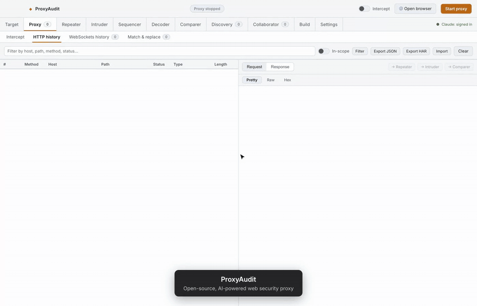

<div align="center">

# ProxyAudit

**An open-source, AI-powered web security testing proxy — a free Burp Suite alternative with a built-in Claude security agent.**

Intercept, replay, fuzz and audit HTTP/HTTPS and WebSocket traffic, then let an AI agent review every endpoint and JavaScript file for vulnerabilities.

[](LICENSE)


[](CONTRIBUTING.md)



<sub>100-second tour · [full-quality MP4](docs/proxyaudit-demo.mp4)</sub>

[Features](#features) · [Quick start](#quick-start) · [AI agent](#ai-security-agent) · [Mobile testing](#mobile-app-interception-ios--android) · [Contributing](#contributing)

</div>

---

> ⚠️ **Authorized testing only.** Use ProxyAudit only on systems you own or
> have explicit written permission to test. Intercepting other people's traffic
> may be illegal where you live.

## What is ProxyAudit?

ProxyAudit is a desktop **intercepting proxy for penetration testing, bug bounty
hunting and web application security research**. It covers the everyday
Burp Suite workflow (Proxy, Repeater, Intruder, Sequencer, Decoder, Comparer,
Collaborator, Extender) and adds an **AI pentesting assistant** that can read
your captured traffic, map the attack surface, and write up findings.

- **Free and open source** (MIT) — no license key, no feature paywall.
- **AI-native** — Claude audits endpoints and JS files, runs recon, and drives
  a browser for you. Works with your existing `claude login`; no API key
  required.
- **Lightweight** — Electron + Node.js, starts in seconds, no JVM.

## Features

### Core proxy toolkit

| Tool | What it does |
| --- | --- |
| **Proxy & HTTP history** | HTTP/HTTPS MITM interception with an auto-generated CA, full request/response capture and decompression |
| **Intercept** | Hold requests in-flight, edit method/path/headers, forward or drop |
| **Target / site map** | Host → path tree built automatically from captured traffic |
| **Repeater** | Edit and resend any request across multiple tabs |
| **Intruder** | Payload fuzzing with `§positions§` — Sniper, Battering ram, Pitchfork, Cluster bomb |
| **Sequencer** | Session-token randomness analysis (per-char and overall Shannon entropy) |
| **Decoder** | Stackable Base64, URL, HTML, Hex, ASCII, Gzip and JWT encode/decode, plus smart-decode |
| **Comparer** | Line- or word-level visual diff |
| **Content discovery** | Directory and file brute-forcing with built-in or custom wordlists |
| **Scope** | Include/exclude host rules; filter history to in-scope traffic |
| **Match & Replace** | Rewrite requests and responses as they pass through |
| **WebSockets** | Live capture of WebSocket connections and every frame |
| **Collaborator** | Out-of-band interaction logger over a `cloudflared` tunnel for blind SSRF / XSS / XXE / webhooks |
| **Export / import** | Save history as JSON or HAR 1.2; re-import JSON |
| **Open browser** | One click launches Chrome / Brave / Edge pre-wired to the proxy in an isolated profile, cert trust already handled |

### AI security agent

- **Endpoint & JavaScript auditor**: select a request and click **◆ Audit
  endpoint** or **◆ Audit JS**, or audit every captured JS file in bulk. The
  agent looks for IDOR, injection, auth flaws, leaked secrets, dangerous sinks
  and more.
- **Agent chat ("Build")**: ask in plain English ("map the attack surface of
  this host", "write a PoC for the IDOR on `/users/{id}`"). The agent uses
  proxy tools to read history, replay requests and report findings.
- **Parallel subagents**: one conversation can fan out to `security-auditor`
  and `recon` subagents to audit a large target concurrently. Multiple chats
  keep running in the background.
- **Subdomain recon**: passive subdomain enumeration from certificate
  transparency logs (crt.sh) with a HackerTarget fallback.
- **Browser control**: the agent can drive a launched test browser or your own
  Chrome through the bundled [Chrome extension](extension/README.md).
- **Model choice**: Haiku, Sonnet or Opus, chosen in Settings.

### Plugins (Extender-style)

Write JavaScript security plugins that hook proxied traffic:

```js
register({
  name: 'Missing HSTS',
  onResponse(flow, api) {
    if (flow.url.startsWith('https://') && !flow.response.headers['strict-transport-security']) {
      api.finding({ title: 'Missing HSTS header', severity: 'Low', flowId: flow.id });
    }
  },
});
```

Plugins get `api.log()`, `api.finding({title, severity, detail, flowId})` and
**`api.ai(prompt)`**, a Claude call that lets you build AI-powered checks. Run
them over captured history or toggle them live. Plugins live in
`~/.proxyaudit/plugins/`.

### Mobile app interception (iOS & Android)

Turn on **Settings → 📱 Mobile interception** to expose the proxy on your LAN.
Point the phone's Wi-Fi proxy at your Mac, then open the cert URL shown in
Settings (`http://<your-mac-ip>:8099/`) to install the CA in two taps.
Per-OS steps are in the app. Apps that use certificate pinning may need
additional tooling such as Frida.

## Quick start

**Requirements**

- macOS, Node.js 24 LTS or newer (`nvm use` picks it up from `.nvmrc`)
- For AI features: the [Claude Code CLI](https://docs.anthropic.com/en/docs/claude-code)
  logged in once with `claude login` (or `ANTHROPIC_API_KEY` set)
- Optional: `cloudflared` for Collaborator (`brew install cloudflared`)
- Optional: any Chromium-based browser for **Open browser**

**Install and run**

```bash
git clone https://github.com/evilboyajay/proxyaudit.git
cd proxyaudit
nvm use          # optional: switches to Node 24 from .nvmrc
npm install
npm start
```

**First-time setup**

1. Click **Start proxy** (default `127.0.0.1:8080`).
2. The easiest route is **Open browser**, which launches a pre-configured
   browser. Nothing else is needed.
3. To use your own browser or system proxy instead, [install the CA
   certificate](#installing-the-ca-certificate), then point HTTP and HTTPS
   proxy to `127.0.0.1:8080`.
4. Browse your target. Traffic appears under **Proxy**.

### Installing the CA certificate

To read HTTPS traffic, ProxyAudit signs certificates with its own CA. The CA is
generated on first start and is unique to your machine; it is never shipped in
this repo.

- **Location:** `~/.proxyaudit/certs/ca.pem` (Settings → **Reveal in Finder**,
  or menu **Proxy → Reveal CA Certificate**).
- **macOS (GUI):** double-click `ca.pem`, add it to the *login* keychain, open
  it in Keychain Access and set **Trust → When using this certificate → Always
  Trust**.
- **macOS (terminal):**

  ```bash
  security add-trusted-cert -r trustRoot \
    -k ~/Library/Keychains/login.keychain-db ~/.proxyaudit/certs/ca.pem
  ```

- **Firefox** keeps its own store: Settings → Privacy & Security →
  Certificates → **View Certificates** → **Import** `ca.pem` and tick *Trust
  this CA to identify websites*.
- **iOS / Android:** see [Mobile app interception](#mobile-app-interception-ios--android).
- **Not needed** when you use **Open browser**.

> 🔒 Anyone holding your CA's private key could intercept traffic from your
> machine. Never share `~/.proxyaudit/certs`, and remove the certificate from
> Keychain Access when you stop testing. To regenerate it, delete
> `~/.proxyaudit/certs` and restart ProxyAudit.

## Keyboard shortcuts

Burp-style defaults (⌘ on macOS). Press **⌘/** in the app to see them all.
Every shortcut can be remapped in Settings.

| Shortcut | Action |
| --- | --- |
| ⌘R / ⌘I | Send selected request to Repeater / Intruder |
| ⌘⇧R / ⌘⇧I | Jump to Repeater / Intruder |
| ⌘↵ | Send / run in the current tool |
| ⌘⇧C | Send selected response to Comparer |
| ⌘B / ⌘⇧B | Base64 encode / decode selection |
| ⌘U / ⌘⇧U | URL encode / decode selection |
| ⌘H / ⌘⇧H | HTML encode / decode selection |
| ⌘⇧D | Smart-decode selection |

## Build a .app / .dmg

```bash
npm run dist   # dist/ProxyAudit-*.dmg (arm64 + x64)
npm run pack   # unpacked .app for quick local testing
```

## Architecture

```
src/
  main/                 Electron main process
    main.js             Window, menu, IPC wiring
    proxy/engine.js     MITM proxy (http-mitm-proxy): capture, intercept, match & replace
    proxy/repeater.js   Request sender for Repeater
    audit/auditor.js    Claude Agent SDK auditor
    assistant.js        Agent chat, tools and subagents
    intruder.js · sequencer.js · discovery.js · recon.js · collaborator.js
    scope.js · matchreplace.js · exporter.js · plugins.js · certserver.js
    browser.js · browsercontrol.js · extension-bridge.js
  preload/preload.js    contextBridge, the only renderer ↔ main surface
  renderer/             UI (plain JS, no framework)
extension/              MV3 Chrome extension for agent browser control
test/renderer-qa.js     Headless jsdom QA harness
```

The renderer is sandboxed (`contextIsolation` on, `nodeIntegration` off) and
talks to the main process only through the whitelisted `window.api` bridge.

## Roadmap

Ideas for contributors. Open an issue before starting large work.

- [ ] Windows and Linux builds
- [ ] HTTP/2 support (the proxy is HTTP/1.1 + WebSocket today)
- [ ] Body editing in live Intercept (use Repeater for now)
- [ ] Persist captured history to disk across sessions
- [ ] Active scanner checks
- [ ] Plugin gallery and examples

## Contributing

Contributions are welcome: bug reports, features, plugins and docs.

1. Fork the repo and create a branch: `git checkout -b feat/my-feature`
2. `nvm use && npm install && npm start` to run locally (Node 24+)
3. Run the QA suite: `npm run qa`
4. Open a pull request describing what changed and why

See [CONTRIBUTING.md](CONTRIBUTING.md) for details. Please report security
vulnerabilities in ProxyAudit itself privately via
[GitHub Security Advisories](https://github.com/evilboyajay/proxyaudit/security/advisories/new)
rather than public issues.

## FAQ

**Is ProxyAudit a replacement for Burp Suite?**
It covers the core manual-testing workflow of Burp Suite Community and
Professional (proxy, repeater, intruder, sequencer, decoder, comparer,
collaborator, extensions) and adds AI auditing. It doesn't yet have an active
scanner.

**Do I need an Anthropic API key?**
No. If you've run `claude login`, ProxyAudit uses that session. An
`ANTHROPIC_API_KEY` works too. Everything except the AI features works without
either.

**Does it work on Windows or Linux?**
Only macOS is supported right now. Cross-platform builds are on the roadmap
and a good first contribution.

## License

[MIT](LICENSE). Burp Suite is a trademark of PortSwigger Ltd. ProxyAudit is an
independent project and is not affiliated with PortSwigger.

<sub>Keywords: intercepting proxy, web security testing, penetration testing tool, Burp Suite alternative, open source pentest proxy, AI security scanner, bug bounty tools, MITM proxy, HTTP proxy, API security testing, Claude AI agent, OWASP, mobile app pentesting</sub>
